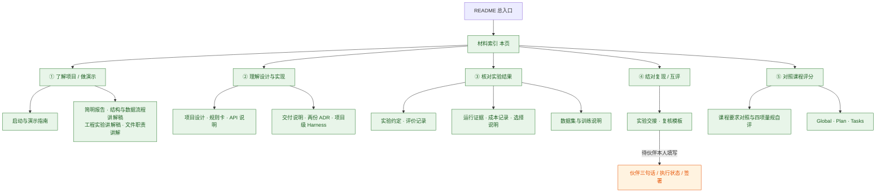

# 材料索引：一页看懂项目，再决定去看哪一份

这份索引做三件事：**先给你关键事实速查**（不用点开任何文件就知道项目和实验现在是什么状态），**再给一张导航图**（看清材料之间的关系与分支），**最后按用途列出每份文档的核心内容**（读完这一行就知道值不值得点开）。不重复正文；逐项课程对照见[课程要求对照与四项量规自评](课程要求对照.md)，逐文件职责见[目录职责讲解](项目结构设计与文件职责讲解.md)。

---

## 一、关键事实速查

### 项目一句话

本机离线运行的 Web 日志审计程序：导入 JSONL 或 Common/Combined 日志 → 规则匹配产生带 `eventIds` 的候选告警 → 人工处置留痕；网页默认 **P2-R1**，**P2-R2** 是只在实验里使用的「获批压测清单」候选。

### 实验结果（一次真实运行，测试分区，统计单位＝完整会话）

| 版本 | TP | FP | FN | TN | Precision | Recall | FPR | 待复核会话 |
| --- | ---: | ---: | ---: | ---: | ---: | ---: | ---: | ---: |
| P2-R1 固定规则（默认） | 2 | 1 | 0 | 1 | 66.7% | 100% | 50% | 3 |
| P2-R2 外部批准清单（候选） | 2 | 0 | 0 | 2 | 100% | 100% | 0% | 2 |

输入规模：8 个完整会话／94 条记录（开发／测试各 4 会话）。质量门槛通过：两个目标异常会话在两版中都检出，FN＝0，`event_id` 可回查原始行。

### 六条逐次耗时（毫秒，3 轮 × 2 版，全部 completed）

| 轮次 | P2-R1 | P2-R2 |
| ---: | ---: | ---: |
| 1 | 13.4951（含预热） | 0.9123 |
| 2 | 1.1590 | 0.6807 |
| 3 | 0.6583 | 0.6687 |

失败 0 次、重跑 0 次（仅覆盖 `analyze()` 内部）。第 3 轮 P2-R1 反而略快，**所以不宣称候选更快**，六轮全部摆出、不挑最快一次。

### 决定、状态与环境

| 项 | 当前事实 |
| --- | --- |
| 最终决定 | **保留 P2-R1 为网页默认，P2-R2 列为「值得用独立真实样本继续验证」**；不采用、不部署、不宣称准确率提升。理由见[选择说明四句话](decision.md)。 |
| 成本边界 | 唯一完整数值是上面 6 条耗时；人工复核时间、清单准备与维护、历史开发投入均**未知**，后续改动**未测**。见[成本记录](../evidence/cost.md)。 |
| 执行状态 | 本机合成样本实验：**本人运行**；伙伴独立复现（T-07）与真实业务校准（T-08）：**待外部参与者**，填写栏留白。 |
| 运行环境 | Node v22.22.2 / win32 / x64；实验运行时提交 `91ecf2b`，运行号 `1794484267202-57b7e25e-406a-459d-b251-7fce5058dfd8`。 |
| 本机验证 | `npm test` 15/15、`npm run eval` 与 `npm run experiment` 退出码 0。最近一次核对 2026-11-18：本地与远端 `main` 一致；**提交号以 `git log -1` 实测为准，本页不写死 HEAD**。 |

### 三条「不能说」（课件红线）

1. **不能说候选更快** —— 样本小、含预热、第 3 轮方向相反。
2. **不能说真实业务会省人力** —— 人工复核时间与清单维护成本未实测，不能把「待复核 3→2」换算成分钟。
3. **不能说 AI 成本为零 / 后续改动为零** —— 运行期无在线调用不等于历史开发投入为零；后续改动未发生，记「未测」不记 0。

---

## 二、材料导航图

从 README 进来，先看本页的速查卡，再按你要做的事往下走。颜色区分状态：绿色＝已完成可查，橙色＝待外部参与者填写。

若阅读器不渲染上图，下面五组表格逐项列出同一结构，功能完全等价。

---

## 三、按用途找材料（每行给出核心内容）

### ① 了解项目 / 做演示

| 文档 | 读完能回答什么（核心内容） | 状态 |
| --- | --- | --- |
| [启动与演示指南](启动与演示指南.md) | 演示前检查、启动命令、5 步现场演示（5—7 分钟）、终端补充（2—3 分钟）、常见问题、总结话术；照着做就能跑完一次完整演示。 | 已完成 |
| [项目简明报告](项目简明报告.md) | 这项目做什么、怎么工作、文件夹为什么这样分、适用范围；适合第一次接触时快速建立整体印象。 | 已完成 |
| [项目结构与数据流程讲解稿](项目结构与数据流程讲解稿.md) | 4—5 分钟口头稿：为何这样分目录、一条日志流过的五个步骤、怎样验证设计有效、取舍与边界。 | 已完成 |
| [工程实验讲解稿](工程实验讲解稿.md) | 4 分钟口头稿：一条数据（`test-load` 六步证据链）、一个取舍（FP 降但成本未知，所以只到「继续验证」）、一个限制（8 会话、失败机制未检验、伙伴未复现、约定五字段事后补齐）。对应量规 R5。 | 已完成 |
| [文件职责讲解](项目结构设计与文件职责讲解.md) | 逐个讲 `src/analysis`、`core`、`domain`、`server`、`public`、`fixtures`、`scripts`、`tests`、`docs` 的职责，最后用一次导入串起所有目录。 | 已完成 |

### ② 理解设计与实现

| 文档 | 读完能回答什么（核心内容） | 状态 |
| --- | --- | --- |
| [项目设计](project.md) | 输入契约、规则版本契约、证据与处置状态机（NEW→TRIAGED→CONFIRMED/DISMISSED→CLOSED）、复现边界、AI 使用与人工责任。 | 已完成 |
| [规则卡](rules.md) | 4 类单条请求规则（SQL 注入／XSS／路径穿越／敏感路径）＋扫描器特征、4 类 60 秒窗口规则及阈值。 | 已完成 |
| [API 说明](api.md) | `/api/analyze`、`/api/demo`、`/api/history` 与处置接口，报告字段和复核建议。 | 已完成 |
| [交付说明](release.md) | 从干净环境恢复的步骤、版本与变更、人工复核边界。 | 已完成 |
| [ADR-0001](adr/0001-offline-audit-architecture.md) | 为何采用单机离线、规则驱动的可追溯架构：调研、候选方案、决定、验证与回退。 | 已完成 |
| [ADR-0002](adr/0002-approved-load-experiment.md) | 为何获批压测清单只作候选规则的外部上下文，不推断到 IP／路径／标签；风险与回退。 | 已完成 |
| [项目级 Harness](../AGENTS.md) | 开发与 AI 操作约定：一次只改一个可解释因素、不提交真实日志与 `data/`、提交前跑 `npm test`（涉及规则再跑 `npm run eval`）、不凭自述声称通过或签署。 | 已完成 |

### ③ 核对实验结果

| 文档 | 读完能回答什么（核心内容） | 状态 |
| --- | --- | --- |
| [实验约定](experiment.md) | 五句约定、伙伴独立运行 4 步、成本与选择、规则版本边界；课前写死、看到结果后不换尺子。 | 已完成 |
| [评价记录](evaluation.md) | 会话级 TP/FP/FN/TN 与三个分母定义、两版结果表、六条逐次耗时表、决定与边界。 | 已完成 |
| [实验约定数据](../fixtures/experiment-plan.json) | 五句约定的机器可读版；含事后补的 5 个文档字段（停止安排／失败策略／执行状态／不换尺子／完成标准），9 个影响结果的字段零改动、不追溯适用于本次运行。 | 已完成 |
| [运行证据索引](../evidence/README.md) | 执行状态「本人运行」、为何只把 `result.json` 入库、六条逐次表、指标汇总、`test-load` 六步证据链抽查、复现命令与边界。 | 已完成 |
| [逐次原始记录](../evidence/run-2026-11-12/result.json) | 原样固化的逐次结果，`status`／`elapsedMs`／计分／源文件哈希；sha256 `90b3a9aa…`，任何数值未改。 | 已完成 |
| [补记元数据](../evidence/run-2026-11-12/manifest.json) | 执行状态、运行时提交 `91ecf2b`、Node 环境、命令退出码、文件哈希、约定事后补字段说明（`appliesToThisRun: false`）。 | 已完成 |
| [成本记录](../evidence/cost.md) | 阶段／数值／单位／来源／是否完整主表、逐次明细、最相关三项与不能推出的结论；未知不补零、重叠时间不相加。 | 已完成 |
| [选择说明](decision.md) | 条件／结果／决定／边界四句话，以及 6 种「什么变化会让我们重新比较」的触发条件。 | 已完成 |
| [数据集与训练说明](数据集与训练说明.md) | 数据集怎么确定性生成、8 会话／94 条、标签隔离与批准清单来源；以及为何**没有训练/微调**（规则驱动、ADR-0001 的范围决定），对应表单「其他」一项。 | 已完成 |

### ④ 结对复现 / 互评

| 文档 | 读完能回答什么（核心内容） | 状态 |
| --- | --- | --- |
| [实验交接](experiment.md) | 伙伴独立运行的 4 个步骤、两个版本与输入、真实运行入口；项目组入口已实测可用。 | 已完成 |
| [复核模板](peer-review.md) | 交接包四件、20 分钟安排（5 确认／10 执行／5 写范围）、评价字段、重点 Claim、有限对抗检查；模板与入口齐备。 | 已完成 |
| 同上的「伙伴三句话」栏 | 「我实际重新做了什么／我的结果在哪里／我没有检查什么」＋执行状态、差异定位、人工签署。 | **空白，待伙伴本人填写（T-07）** |
| [运行证据索引](../evidence/README.md) | 原始结果位置，供伙伴核对；**不代替伙伴执行**，只阅读报告并赞同不算复现。 | 已完成 |

### ⑤ 对照课程要求 / 评分

| 文档 | 读完能回答什么（核心内容） | 状态 |
| --- | --- | --- |
| [课程要求对照与量规自评](课程要求对照.md) | 四项量规各 25 分（比较说得清／记录查得到／复核有边界／本人讲得明）逐项列出证据在哪、怎么核对、还缺什么；执行状态一览、课件页码→实现映射、评分边界；**不预填分数**。 | 已完成 |
| [Global](Global.md) | 总目标、4 条成功判据、范围与责任、当前状态。 | 已完成 |
| [Plan](Plan.md) | 阶段计划 P0—P4、变更流程、阶段门槛；注明是事后整理，不是项目开始前的原始计划。 | 已完成 |
| [Tasks](Tasks.md) | T-01—T-08 任务、证据链接与状态，本机核对命令；T-07／T-08 如实标注待执行。 | 已完成 |

---

## 四、状态速览（避免把未做的当成已做）

- **已完成**：代码、测试、运行入口、文档、本机合成样本实验、Git 历史与推送。
- **待外部参与者**：T-07 伙伴独立复现与签署、T-08 真实业务校准——模板与交接齐备，填写栏留白，不由项目组或 AI 代填。
- **按范围排除**：账号认证、加密存储、实时采集、自动封禁——文档已声明，不是遗漏。
- **未知不补零**：人工复核时间、清单维护与历史开发投入未实测，见[成本记录](../evidence/cost.md)。
